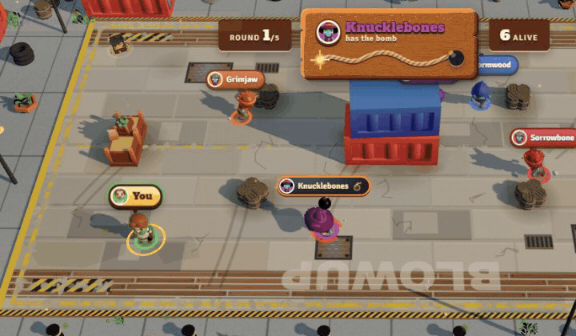

<p align="center"><a href="https://blowup-magicblock.onrender.com/"></a></p>

<h1 align="center">Pass the bomb. Don't be holding it.</h1>

<p align="center">Up to six players share one bomb on the harbour dock. Tag someone or throw it to pass it on.<br>Each pass resets the fuse. If it goes off in your hands, you're out.</p>

<p align="center"><a href="https://blowup-magicblock.onrender.com/"></a></p>

<p align="center"></p>
<p align="center"><em>Knucklebones tags you and the bomb changes hands.</em></p>

<p align="center">Built for <strong>MagicBlock Solana Blitz V10</strong><br>Online matches run on a MagicBlock Ephemeral Rollup. MagicBlock VRF picks the opening holder and the fuse length.</p>

<h2 align="center">How to play</h2>

1. Open **[BlowUp](https://blowup-magicblock.onrender.com/)** on desktop, enter a name, pick a character and choose **Online**, then click **Play**. Quick play fills empty seats with bots after eight seconds.
2. Move with **WASD**, dash with **Space**, **left-click** to throw and **right-click** to tag. For a practice round, choose **How to play**.
3. After the final elimination, open **Match details**. When settlement completes, **View match on Solana** opens the recorded result.

**Private rooms.** Choose **Private** and share the invite link. With bot fill off, two to six players can join. Use separate devices or browser profiles, then ready up before the host starts.

**Wallet progress.** Link a wallet before playing. One signed message links it for up to 24 hours on that site. A match session key handles gameplay.

<h2 align="center">Match transactions</h2>

<details>
<summary><strong>View transactions from one completed match</strong></summary>

| During the match | What happened on-chain |
| --- | --- |
| **Match setup** | The sponsor creates the match and player accounts on Solana devnet, then delegates them to the Ephemeral Rollup. [Match delegation](https://explorer.solana.com/tx/5RwHg14NMGVzt8YrtZtTH6sQv8QKjfFRwakjrhPRDo4mM9TizD1A5zLx3jvk6WARMjLAbcLiFPBWE1cXk9nfBfU1?cluster=devnet) |
| **First holder and fuse** | BlowUp receives a random value from MagicBlock VRF. Open **Logs** and look for `round 1 holder 2 fuse 9716ms`. Player 2 started with the bomb and a 9.716-second fuse. [VRF fulfillment](https://explorer.solana.com/tx/4A597SREYFejvPEbnCKKFq1bBsRwwEMXL93V9DkLshPDAqkYqm5HLPVmJUjirvLvJ5m6FrAgpw55AifYjt3Wweoi?cluster=custom&customUrl=https%3A%2F%2Fdevnet-as.magicblock.app) |
| **Players move and pass** | Clients send position updates at up to 10 Hz. The rollup checks session authority, input sequence, movement bounds, bomb ownership and transfer range. [Gameplay input](https://explorer.solana.com/tx/5zu8uNn5DWhxrMUgAGnUVcNd53qmcezZFUafZgztP5RSd1kALWbgWswKs1U8RrVRQxKtQdLaCc5Pb6c6yvZhqg2B?cluster=custom&customUrl=https%3A%2F%2Fdevnet-as.magicblock.app) |
| **One player remains** | The lobby commits the final state and undelegates the accounts. BlowUp records the winner and placements on Solana. Eligible linked wallets receive one profile credit per match. [Undelegation](https://explorer.solana.com/tx/2vXqDffABqqzCW9xJ6FA1gyPjLGDEMM7RkMN24npczLhhSJpwB1xCP87kAHcPm3JExoBT1mt6a35JqXUVRPHZx7i?cluster=devnet) · [Recorded result](https://explorer.solana.com/tx/3h16dakSt6fqZJurKDL4475hJCxUvYPxJJB44bkH2B5RGFQ9G2hctiWz7zcjsmimwWiznNNXunQ7tmrYGrs3H9Fb?cluster=devnet) |

All four rows trace the same completed online match. The ER links open Solana Explorer with the MagicBlock Asia devnet RPC selected.

</details>

<h2 align="center">Multiplayer tests</h2>

| Test | Result |
| --- | --- |
| **Private room** | All three browsers showed the same winner after two elimination rounds. We reproduced both opening draws from the transaction logs. The linked wallet was credited once. [Private-room result](https://explorer.solana.com/address/6pvJg3QZsoQSjo1dsaUFYcZpoMYohRTssxx1hSHDZuRm?cluster=devnet) |
| **Quick play** | Three scripted clients and three bots finished a match with 14 transfers. Eight checks passed across matchmaking, takeover, rejoin and settlement. [Quick-play result](https://explorer.solana.com/address/7bJgXkxHRJfQKVuywZFredRg4doxCmjoMCrJPrAzoZAc?cluster=devnet) |

In the private-room browser run, one seat missed its first input window and a takeover bot made the recorded pass. We haven't tested this with three people on separate devices yet. Earlier input-visibility measurements were **108 ms median and 163 ms p95**, above the 100 ms p95 target. Pickups, abilities, weather physics and full projectile and obstacle checks are offline features. [Verification report](docs/submission-check.md) · [Latency measurements](docs/phase-00-findings.md)

<details>
<summary><strong>Recompute the private room’s opening draws</strong></summary>

The verifier reads public callback history. Run from the repository root.

```bash
npm ci
npm ci --prefix chain
npx tsx chain/verify-draws.ts 42gzkLfEQjCeVMp41KJSJxRCyB5kRM4vzT3DvdAmbCB2 https://devnet-as.magicblock.app/
```

</details>

<details>
<summary><strong>Run locally and explore the code</strong></summary>

```bash
npm ci
npm run dev
```

Open `http://localhost:5173` for offline play. For online play, run `npm run server` in a second terminal with a funded Solana devnet lobby signer. Set `AUTHORITY_KEY` to the key file path, or use the gitignored default `.keys/authority.json`. Vite proxies `/api` to port `8787`.

For a hosted demo, run `npm run build` before `npm run server`. The lobby serves the production build and API from the same port, which can sit behind a tunnel. It defaults to three active matches shared by quick play and private rooms. Public matches spend the lobby's devnet SOL. Keep signer files outside the public build. See the [development handoff](docs/HANDOFF.md) for the Anchor toolchain, IDL and operational details.

```bash
npm test
npm run typecheck
cargo test -p blowup --lib
```

## Code map

| Path | Responsibility |
| --- | --- |
| [`programs/blowup/`](programs/blowup/) | Anchor instructions, account validation, VRF callbacks, match rules and settlement |
| [`server/`](server/) | Sponsored matchmaking, private rooms, rollup readiness, bots, takeover and settlement |
| [`src/chain/`](src/chain/) | Browser rollup session, prediction and reconciliation, wallet link and profile reads |
| [`src/game/`](src/game/) · [`src/render/`](src/render/) | Offline simulation and bots, arena layouts, and the React Three Fiber scene |
| [`chain/`](chain/) | IDL, feasibility harness, VRF verification and raw reports |

</details>

<h2 align="center">Credits</h2>

Characters and animations by [KayKit](https://kaylousberg.itch.io). Harbour models from [Kenney](https://kenney.nl) and [Quaternius](https://quaternius.com), with [model credits](public/models/CREDITS.md). Sound effects and jingles from [Kenney](public/audio/CREDITS.md). The painted UI uses CraftPix assets under their [separate terms](public/ui/LICENSE.txt). Fonts are Alfa Slab One and Signika. The BlowUp logo was made for the game.
